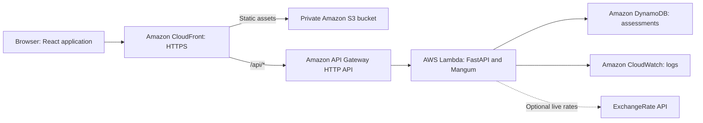

# Sentinel · Multi-Currency Payment Risk Platform

Sentinel evaluates international payment requests, converts their value to USD, and returns an explainable **approve**, **review**, or **deny** decision. Its dashboard brings payment validation, risk insights, and searchable transaction history into one workspace.

**Live website:** [dwpr95kpfzqhm.cloudfront.net](https://dwpr95kpfzqhm.cloudfront.net)

**Deployment:** AWS Mumbai (`ap-south-1`) · **[Build and deployment status](https://github.com/ajay2005k/Multicurrency/actions/workflows/deploy.yml)**

The hosted workspace requires your workspace access key. Enter the key's value on the sign-in screen; keep it out of source code and recordings.

The current deployment uses fixed reference exchange rates and deterministic risk rules. Sentinel assesses payment risk; it does not transfer money or authorize payments through a payment processor. Amazon Fraud Detector and a trained machine-learning model are not integrated.

## Features

- **Payment validation:** submit an amount, currency, customer reference, merchant, payment and billing countries, payment method, and new-device signal.
- **Currency conversion:** normalize payments across USD, EUR, GBP, INR, JPY, CAD, AUD, CHF, SGD, and AED.
- **Explainable decisions:** see a risk score and the signals contributing to it.
- **Overview:** track USD volume, approval rate, flagged transactions, average risk, seven-day activity, and decision distribution.
- **Transaction history:** search and filter persisted assessments, then inspect their details.
- **Retry protection:** repeating an identical request with the same idempotency key returns the original assessment without adding a transaction.
- **Responsive interface:** use the workspace from desktop or mobile screens.

## How a payment is assessed

1. The backend validates the submitted fields and checks request authentication and idempotency.
2. The selected currency provider converts the amount to USD.
3. Risk rules evaluate the USD value, country mismatch, device signal, and the customer's prior assessments.
4. The backend stores the assessment and returns its score, decision, and explanations.
5. The dashboard and transaction history reflect the saved result.

| Risk signal | Points |
|---|---:|
| USD value of at least 10,000 | 45 |
| USD value of at least 2,500 and below 10,000 | 20 |
| Payment and billing countries differ | 25 |
| New device | 15 |
| At least three prior assessments for the customer within ten minutes | 30 |
| Customer has a prior denied assessment | 20 |
| Customer has no previous assessments | 5 |

The score is capped at 100. Scores **below 35 approve**, **35–69 require review**, and **70 or above deny**. A review decision is a recorded classification; there is no reviewer assignment or approval workflow. Payment method is recorded but does not change the score.

## Demonstration scenarios

Use a different, previously unused customer reference for each row so that customer history does not change the expected result. These examples use the deployed reference rates.

| Amount | Currency | Payment / billing country | New device | USD value | Expected decision |
|---|---|---|---|---|---|
| 100 | USD | US / US | No | 100.00 | Approved · score 5 |
| 3,000 | EUR | DE / DE | Yes | 3,260.87 | Needs review · score 40 |
| 15,000 | USD | GB / US | Yes | 15,000.00 | Declined · score 90 |
| 8,350 | INR | IN / IN | No | 100.00 | Approved · score 5 |

For the presentation script, service explanations, and additional checks, see the [faculty demonstration guide](docs/FACULTY_DEMO.md). Use synthetic customer references and payment details during demonstrations.

## Architecture and services



| Component | Technology / service | Purpose |
|---|---|---|
| Frontend | React 19, TypeScript, Vite, custom CSS | Dashboard, validation form, and transaction views |
| Backend | Python 3.12, FastAPI, Pydantic, Mangum | Validation, currency conversion, risk assessment, and API responses |
| Website hosting | Amazon S3 and CloudFront | Private static asset storage and public HTTPS delivery |
| API entry point | Amazon API Gateway | Route requests to Lambda through the same website domain |
| Backend execution | AWS Lambda | Run the Python application on demand |
| Cloud persistence | Amazon DynamoDB | Store assessments and idempotency records |
| Local persistence | SQLite | Run locally without an AWS account |
| Logging | Amazon CloudWatch | Collect backend logs with a 14-day retention period |
| Infrastructure | AWS CloudFormation and IAM | Provision resources and scoped runtime permissions |
| Delivery | GitHub Actions and AWS OIDC | Test and deploy using short-lived AWS credentials |
| Optional live FX credentials | AWS Secrets Manager | Keep an ExchangeRate API key on the backend |

CloudShell is used for deployment setup, not for hosting the running application. The active FX provider is `demo`, which uses fixed reference rates; live ExchangeRate API requests and Secrets Manager integration are optional configurations.

## Automatic deployment

The repository is connected to AWS. GitHub Actions verifies pull requests and publishes passing commits pushed to `main` to the `sentinel-payments` stack in `ap-south-1`.

The workflow runs backend tests, builds the frontend, checks infrastructure templates, and runs browser checks before deployment. It then deploys the application, uploads the website, invalidates the CloudFront cache, and checks the public website, API, and persisted payment decisions. Readiness checks create synthetic launch-verification transactions.

- Commit and push changes to `main` to publish them. Local edits become live only after the deployment succeeds.
- Deploying to the same AWS account, region, and stack preserves the website URL and transaction table.
- The workflow uses AWS OIDC roles; long-lived AWS access keys are not required in GitHub.
- The workspace key belongs in the Actions secret `SENTINEL_WORKSPACE_ACCESS_KEY`. The workflow also accepts the existing `SECRET_KEY_1` secret as a fallback. Values must contain at least 24 characters.
- Set the repository variable `AWS_AUTO_DEPLOY=disabled` to pause automatic publishing.

See [automatic deployment setup and troubleshooting](docs/AUTO_DEPLOY.md) for role configuration, repository variables, and workflow details. The [CloudShell deployment guide](deployment/README.md) documents the alternative package-based deployment and cleanup process.

## Run locally

Use **Python 3.12** and **Node.js 22 or later**. Clone the repository first:

```bash
git clone https://github.com/ajay2005k/Multicurrency.git
cd Multicurrency
```

### macOS / Linux

```bash
python3 -m venv .venv
.venv/bin/python -m pip install -r backend/requirements.lock.txt
npm ci --prefix frontend
./scripts/dev.sh
```

### Windows PowerShell

Run these commands from the repository root:

```powershell
py -m venv .venv
.\.venv\Scripts\python.exe -m pip install -r backend/requirements.lock.txt
npm.cmd ci --prefix frontend
.\.venv\Scripts\python.exe -m uvicorn backend.app:app --port 8000
```

Keep that terminal open. In a second PowerShell terminal, open the same repository folder and start the frontend:

```powershell
npm.cmd run dev --prefix frontend
```

Open **[http://localhost:5173](http://localhost:5173)** for the website. The backend health endpoint is [http://localhost:8000/api/health](http://localhost:8000/api/health). With local API authentication unset, API documentation is available at [http://localhost:8000/docs](http://localhost:8000/docs).

Vite forwards `/api` requests to the backend on port 8000. Both servers must remain running. Local assessments persist in `.local/sentinel.db`, which is excluded from Git. Stop the servers with **Ctrl+C**.

## Configuration

[.env.example](.env.example) lists configuration names. The backend reads its process environment and does **not** automatically load a `.env` file. Set backend variables in your shell or process manager. Never commit credentials.

| Variable | Purpose |
|---|---|
| `FX_PROVIDER` | `demo` by default; use `exchangerate` for live conversion |
| `EXCHANGE_RATE_API_KEY` | Backend API key for live ExchangeRate API conversion, typically used locally |
| `EXCHANGE_RATE_SECRET_ARN` | AWS Secrets Manager ARN containing the plain-text live FX key |
| `STORAGE_BACKEND` | `sqlite` locally or `dynamodb` on AWS |
| `DATABASE_PATH` | SQLite file path; defaults to `.local/sentinel.db` |
| `TRANSACTIONS_TABLE` | Required DynamoDB table name when using cloud storage |
| `APP_API_KEY` | Optional locally and required by the deployment; protects API requests through `X-API-Key` |
| `CORS_ORIGINS` | Comma-separated allowed frontend origins; defaults to `http://localhost:5173` |
| `VITE_API_URL` | Optional frontend API base URL for separate hosting; configured at build time in `frontend/.env.local` |

The hosted frontend and API use the same CloudFront domain. The workspace key entered at sign-in is held in browser session storage. Never put secrets in `VITE_` variables, which are included in the browser bundle.

For live FX on AWS, configure the secret and its permissions as described in the deployment guides; the workflow uses `FX_SECRET_ARN` to supply the backend secret ARN. Live-provider failures return an error without recording a payment or silently substituting reference rates.

## API overview

Cloud-hosted routes require `X-API-Key`, except the public health endpoint.

| Method | Endpoint | Purpose |
|---|---|---|
| GET | `/api/health` | Health status and configured storage, FX, and risk providers |
| GET | `/api/currencies` | Supported currencies |
| POST | `/api/payments/validate` | Create an assessment; requires an `Idempotency-Key` header |
| GET | `/api/transactions` | List assessments with search and decision filters |
| GET | `/api/transactions/{id}` | Retrieve assessment details |
| GET | `/api/dashboard` | Retrieve dashboard metrics |

Idempotency keys must contain 8–128 characters. Reusing a key with the same payload returns the original result; changing the payload returns HTTP 409. A new key creates a new assessment. Invalid inputs return 422, and missing or incorrect authentication returns 401.

## Verification

From the repository root on macOS / Linux:

```bash
.venv/bin/python -m pytest backend/tests -q
npm run build --prefix frontend
```

On Windows, replace `.venv/bin/python` with `.\.venv\Scripts\python.exe` and use `npm.cmd`.

With both development servers running, install the browser and run the browser smoke test:

```bash
npm exec --prefix frontend -- playwright install chromium
npm run test:e2e --prefix frontend
```

For an existing Chromium installation, supply `CHROMIUM_PATH` instead. Set `APP_URL` if the frontend uses another address. Browser tests create synthetic assessments and do not delete application data.

Backend tests cover conversion, decision thresholds, persistence, request validation, idempotency, customer history, velocity, API authentication, and deployment configuration. The GitHub Actions workflow also runs access and API-error browser checks.

## Repository layout

```text
backend/                 FastAPI application, storage adapters, and tests
frontend/                React interface and browser checks
infra/hosting.yaml       Complete application infrastructure
infra/github-oidc.yaml   GitHub OIDC deployment roles
deployment/             Deployment tooling and CloudShell guide
docs/                   Automatic deployment and faculty demo guides
scripts/                 Development, packaging, and OIDC utilities
.github/workflows/       Automated verification and deployment
```

## Current scope

Sentinel provides a working cloud-hosted risk assessment flow with persistent data. Scores are rule-based indicators, not calibrated fraud probabilities. Shared-key access does not provide individual accounts or per-user authorization, and no payment processor, chargeback handling, or human review workflow is included.

Dashboard and history queries currently scan DynamoDB and aggregate records in application memory. Larger workloads need indexed queries, pagination, and precomputed metrics. Velocity checks are not atomic across concurrent Lambda executions. Retained DynamoDB data survives stack deletion; consult the deployment guide before removing resources.

## License

Released under the [MIT License](LICENSE).
