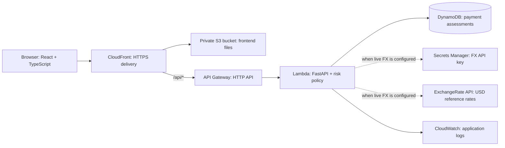

# Sentinel: faculty demonstration guide

## What the project does

“Sentinel is a multi-currency payment risk assessment application. It converts payment amounts to a common USD basis, checks payment details against an explainable risk policy, stores the assessment, and shows the result in an operations dashboard.”

A decision is **approve**, **needs review**, or **decline**. This application assesses a proposed payment; it does not charge a card or transfer funds.

## Architecture

This is the deployment design. Claim these AWS services are working only after the deployment script prints **Deployment verified** and you have opened its HTTPS URL. Before deployment, the development machine uses SQLite rather than DynamoDB.

## Services and where they are used

| Component | Role in this project | What to show or say |
|---|---|---|
| React + TypeScript | Dashboard, validation form, history, and decision explanations | The browser displays results supplied by the backend. |
| Amazon S3 | Stores compiled HTML, CSS, and JavaScript in a private bucket | The bucket is not a public website bucket. |
| Amazon CloudFront | Supplies the public HTTPS website and routes `/api/*` to API Gateway | One URL serves both UI and API. Origin access control protects S3. |
| Amazon API Gateway | Receives HTTP API requests and invokes Lambda; throttles request rates | `POST /api/payments/validate` is the main payment endpoint. |
| AWS Lambda | Executes FastAPI, conversion, fraud rules, and storage operations | No always-running application server or EC2 instance is required. |
| Amazon DynamoDB | Persists transaction details, conversion, risk score, reasons, and decisions | Refresh the page to demonstrate persistence. |
| AWS IAM | Grants Lambda permission to access its own table and logs | Permissions are scoped to the required resources. |
| Amazon CloudWatch | Stores backend execution logs with 14-day retention | Use it to diagnose backend failures. |
| AWS CloudFormation | Creates and updates infrastructure from `infra/hosting.yaml` | The setup is repeatable rather than a list of manual console clicks. |
| AWS CloudShell | Runs the deployment using your logged-in AWS session | It is a deployment terminal, not the website's runtime host. |
| ExchangeRate API | Optional live rates used for conversion | Only claim live rates when the UI says **LIVE RATES**. Otherwise explain the fixed reference dataset. |
| AWS Secrets Manager | Optional storage for the live FX provider key | Used only if a live FX secret ARN is supplied at deployment. |

**Amazon Fraud Detector is not integrated.** The implementation uses a transparent rules engine in Lambda. If asked about the original proposal, explain: “The proposed architecture included Amazon Fraud Detector. This implementation evaluates risk using explicit rules in Lambda; connecting a managed fraud model requires separate account eligibility checks and model integration.” Do not describe the score as a trained AI prediction.

## Suggested 4–5 minute recording

### 0:00–0:35 — Introduce the problem

“Global payments arrive in different currencies, so raw amounts are hard to compare. Sentinel normalizes amounts to USD and combines payment value with behavioral and location signals to produce an explainable assessment.”

Show the public HTTPS address and the Payment overview page. Enter the workspace key before recording, or keep the password field hidden. Do not record AWS credentials, provider keys, or password managers.

### 0:35–1:00 — Explain the dashboard

Point to total volume in USD, approval rate, flagged payments, average risk, the last-seven-days activity chart, and decision breakdown. These values come from stored transactions; they are not hard-coded totals.

Explain the rate label:

- **REFERENCE RATES:** “For this recording, currency conversion uses a fixed demonstration dataset.”
- **LIVE RATES:** “The backend retrieves USD-based rates from ExchangeRate API.”

A live website and live currency data are separate features.

### 1:00–2:45 — Show three decisions

Use a unique customer for each scenario so prior history does not affect the baseline score. Example names use a recording-specific suffix, such as `alex-recording1@example.com`.

| Scenario | Amount | Currency | Payment / billing country | New device | Expected score / result with reference rates |
|---|---:|---|---|---|---|
| Normal payment | 100 | USD | United States / United States | Off | 5 / Approved |
| Elevated risk | 3,000 | EUR | Germany / Germany | On | 40 / Needs review |
| Multiple risk signals | 15,000 | USD | United Kingdom / United States | On | 90 / Declined |

Use merchant names such as **Northstar Studio**, **Atlas Travel**, and **Harbor Electronics**. Explain each result in the details dialog:

1. A new customer contributes 5 points.
2. A payment of at least $2,500 adds 20 points, and a new device adds 15. The EUR scenario converts to $3,260.87 with reference rates, producing 40 points.
3. A payment of at least $10,000 adds 45 points; a country mismatch adds 25; a new device adds 15; a new customer adds 5. Total: 90.

These are relative risk scores, not percentages or calibrated fraud probabilities. “Needs review” is a decision label; a reviewer approval workflow is not implemented.

### 2:45–3:20 — Show history and persistence

Close the result, select Transactions, filter to Needs review or Declined, and search for a customer. Open a row to show the stored reasons and conversion. Refresh the page and show that records remain.

“In AWS, DynamoDB stores these assessments. Repeating an API request with the same idempotency key returns the original result rather than writing a duplicate.”

The form creates a fresh key when its values change; identical network retries preserve the key.

### 3:20–4:15 — Explain the cloud architecture

Use the architecture diagram above. Walk through:

“CloudFront serves the React application from private S3 storage. Requests under `/api` go to API Gateway and then Lambda. Lambda converts the currency, evaluates risk, and writes the assessment to DynamoDB. CloudWatch supports diagnosis, IAM scopes access, and CloudFormation defines the infrastructure.”

If you enabled live rates, add: “Lambda reads the provider key from Secrets Manager and calls ExchangeRate API over HTTPS.”

### 4:15–4:45 — Explain engineering choices and boundaries

- **USD normalization:** makes thresholds comparable across currencies.
- **Explainable rules:** makes each decision inspectable and repeatable.
- **Idempotency:** protects against duplicate transaction writes on retries.
- **Serverless hosting:** supports a small demonstration without managing an always-on server.
- **Access control:** this version uses a shared workspace key. Individual logins, roles, and multi-tenant isolation are future work.
- **Scale:** this version scans small tables for history and dashboards. Indexed queries and aggregate records are needed for larger workloads; velocity checks are not atomic across concurrent Lambda instances.

Close with: “The demonstrated system completes the assessment workflow from browser input through persistent storage and explainable output. Production expansion would add identity management, stronger concurrency controls, and a validated fraud model.”

## Questions you may be asked

**Does this detect actual fraud?**
It flags risk using explicit conditions. It does not establish that a transaction is fraudulent. Real fraud detection requires labeled data, validation, monitoring, and feedback.

**Why convert before scoring?**
A threshold like $10,000 should represent the same value regardless of whether the incoming payment uses USD, INR, or EUR.

**What happens when the FX provider fails?**
With live FX enabled, the API returns a service-unavailable error without recording the payment. It does not silently substitute demonstration rates.

**Is this a payment gateway?**
No. It is a risk assessment API that could be called before a payment processor authorizes a payment.

**Which database is used?**
SQLite for local development; DynamoDB for the CloudShell deployment.

**Where is the machine-learning model?**
There is no trained model in the current implementation. The rules are deliberately visible on the Risk insights page.
